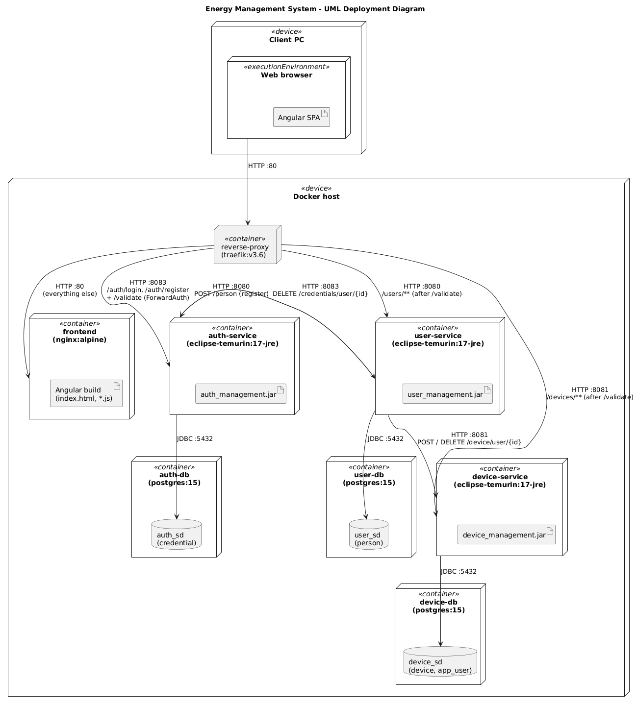

# Energy Management System (Distributed Systems)

Microservices behind a Traefik API gateway, with JWT authentication and an Angular frontend.

## Architecture

```
Browser ──► Traefik :80 ──┬─ /auth/login, /auth/register ─────────────► auth-service:8083   ──► auth-db   (credentials)
                          ├─ /users/**   ──[ForwardAuth]──[strip]─────► user-service:8080   ──► user-db   (persons)
                          ├─ /devices/** ──[ForwardAuth]──[strip]─────► device-service:8081 ──► device-db (devices, app_user)
                          ├─ /{users,devices,auth}/swagger-ui, /v3/api-docs ──[strip]──► Swagger of that service (public)
                          └─ everything else ─────────────────────────► frontend:80 (nginx + Angular)
```

UML deployment diagram: [`docs/deployment.png`](docs/deployment.png) (source: [`docs/deployment.puml`](docs/deployment.puml)).



| Service | Module | Responsibility |
|---|---|---|
| `auth-service` | `services/auth_management` | `/login`, `/register`, issues JWTs (`role`, `userId`), `/validate` for Traefik ForwardAuth |
| `user-service` | `services/user_management` | CRUD on persons (`/person`): id, username, name, address, age |
| `device-service` | `services/device_management` | CRUD on devices (`/device`): id, name, description, address, max consumption, owner. Local `app_user` table with the user ids (`/device/user/{userId}`) |
| `frontend` | `frontend` | Angular SPA: login/register, admin pages, client page |
| `common` | `common` | Shared exceptions, error handler, `EndpointPaths` |

### How a request is authorized
1. The user logs in at `POST /auth/login` and gets a JWT signed with HS256. The token holds the `role` (`ADMIN` / `CLIENT`) and the `userId`.
2. The Angular interceptor (`frontend/src/app/auth/auth.interceptor.ts`) adds `Authorization: Bearer <token>` to every request.
3. For `/users/**` and `/devices/**`, Traefik first calls `auth-service /validate` (ForwardAuth middleware `jwt-auth`).
   - No token, a bad token or an expired token gets **401**.
   - A valid token without permission gets **403** (rules in `AccessPolicy.java`).
   - Otherwise the request is forwarded, with the `X-User-Id` and `X-User-Role` headers added.
4. Permissions:
   - **ADMIN** has full access to users and devices.
   - **CLIENT** can only `GET /users/person/{ownId}` and `GET /devices/device/user/{ownId}`.

Only `/auth/login` and `/auth/register` are routed publicly. `/validate` and `/credentials` are reachable only on the internal Docker network. The backends have no host ports, so the gateway is the only way in.

### Cross-service consistency (user ↔ device synchronization)
The device DB keeps a local table `app_user(id)` with only the ids of the users. `device.user_id` is a foreign key
to it (`ON DELETE SET NULL`): one user has many devices.

- **Create a user** (register or admin "New user"): auth-service calls user-service `POST /person`. user-service saves
  the person in the user DB, then calls device-service `POST /device/user/{id}`, which inserts the id into `app_user`.
  Then auth-service stores the credential (hashed password) linked to that `userId`.
  If device-service is down, user-service deletes the person again and returns 503, so both DBs stay the same.
- **Assign a device:** device-service checks that the owner id exists in its own `app_user` table (no call to
  user-service). Unknown id → **404**.
- **Delete a user:** user-service first calls auth-service `DELETE /credentials/user/{id}` and device-service
  `DELETE /device/user/{id}`, then deletes the person. device-service deletes the id from `app_user` with one direct
  `DELETE` query (no `SELECT` first); the foreign key sets `user_id = NULL` on that user's devices (they become
  unassigned). If a call fails, the person is kept and the API returns 503.

## Build & run

Requirements: only Docker (with Compose). Maven and Node run inside the Docker builds (multi-stage Dockerfiles).

```bash
# build all images and start everything (proxy, frontend, 3 services, 3 databases)
docker compose up --build        # add -d to run in the background

# start from empty databases again (deletes the DB volumes)
docker compose down -v

# optional: load-balance a service across replicas
docker compose up -d --scale user-service=2
```

The first build downloads the Maven and npm dependencies and takes a few minutes. After the containers start,
wait ~20 seconds until the Spring services are ready.

### URLs

| What | URL |
|---|---|
| App (frontend) | http://localhost |
| Traefik dashboard | http://localhost:8082 |
| Swagger UI – user-service | http://localhost/users/swagger-ui |
| Swagger UI – device-service | http://localhost/devices/swagger-ui |
| Swagger UI – auth-service | http://localhost/auth/swagger-ui |
| OpenAPI JSON | http://localhost/users/v3/api-docs, http://localhost/devices/v3/api-docs, http://localhost/auth/v3/api-docs |

Swagger is public (no token). To try the protected endpoints: call `POST /login` in the auth-service Swagger
(or `curl`, see below), copy the `token`, click **Authorize** in the user/device Swagger and paste only the token
(Swagger adds `Bearer ` itself). Requests go through Traefik, so the role rules still apply (CLIENT gets 403 on admin endpoints).
`/login` and `/register` are public and need no token.

### Test accounts

| Username | Password | Role | Notes |
|---|---|---|---|
| `admin` | `admin` | ADMIN | created on the first start of auth-service |
| `ion` | `ion123` | CLIENT | owns *Fridge* and *Washing machine* |
| `maria` | `maria123` | CLIENT | owns *Air conditioner* |

### Database dumps
`db/user_sd.sql`, `db/device_sd.sql`, `db/auth_sd.sql` are `pg_dump`s of the 3 databases (seed data). They were made with:
```bash
docker exec user-postgres   pg_dump -U postgres user_sd   > db/user_sd.sql
docker exec device-postgres pg_dump -U postgres device_sd > db/device_sd.sql
docker exec auth-postgres   pg_dump -U postgres auth_sd   > db/auth_sd.sql
```
You do not need them to run the app: Flyway creates the tables and the seed data on the first start.

For anything beyond local development, create a `.env` file next to `docker-compose.yml`:

```
JWT_SECRET=<at least 32 random characters>
ADMIN_USERNAME=admin
ADMIN_PASSWORD=<strong password>
```

## Test

### Unit tests
```bash
mvn test
# without Maven installed:
docker run --rm -v "$PWD":/src -v m2cache:/root/.m2 -w /src maven:3.9-eclipse-temurin-17 mvn -B test
```
`auth_management` tests cover the JWT round trip and the rejection cases (`JwtServiceTest`), plus the gateway permission rules (`AccessPolicyTest`).

> Known failure: `PersonServiceIntegrationTests.testInsertCorrectWithGetById` fails on the H2 test database: H2 2.x
> stores the UUID in a fixed-length `BINARY(255)` column (padded with zeros), so the lookup by id finds nothing.
> The real app uses PostgreSQL (`BYTEA`), where this works. All other tests pass.

### End-to-end through the gateway (curl)
```bash
# login as admin
TOKEN=$(curl -s -H 'Content-Type: application/json' -d '{"username":"admin","password":"admin"}' \
  http://localhost/auth/login | sed 's/.*"token":"\([^"]*\)".*/\1/')

curl -i http://localhost/users/person                                  # 401, no token
curl -i -H "Authorization: Bearer $TOKEN" http://localhost/users/person # 200

# register a client (creates person + credential), returns the userId
curl -s -H 'Content-Type: application/json' \
  -d '{"username":"ana","password":"pass1","name":"Ana","address":"Str 1","age":18}' \
  http://localhost/auth/register
```
Then log in as `ana`:
- `GET /devices/device/user/<anaId>` returns **200**
- `GET /devices/device` returns **403**

### In the browser
1. Open http://localhost and log in as `admin`. You can manage users and devices, and assign a device to a user using the **Owner** dropdown.
2. Log out and use **Register** to create a client. The client only sees **My devices**.
3. Open `/admin/users` as a client. The route guard redirects you to `/my-devices`.

## Ports

| Port (host) | What |
|---|---|
| 80 | Traefik (app entry point) |
| 8082 | Traefik dashboard |
| 5432 / 5433 / 5434 | user-db / device-db / auth-db (for local inspection) |
